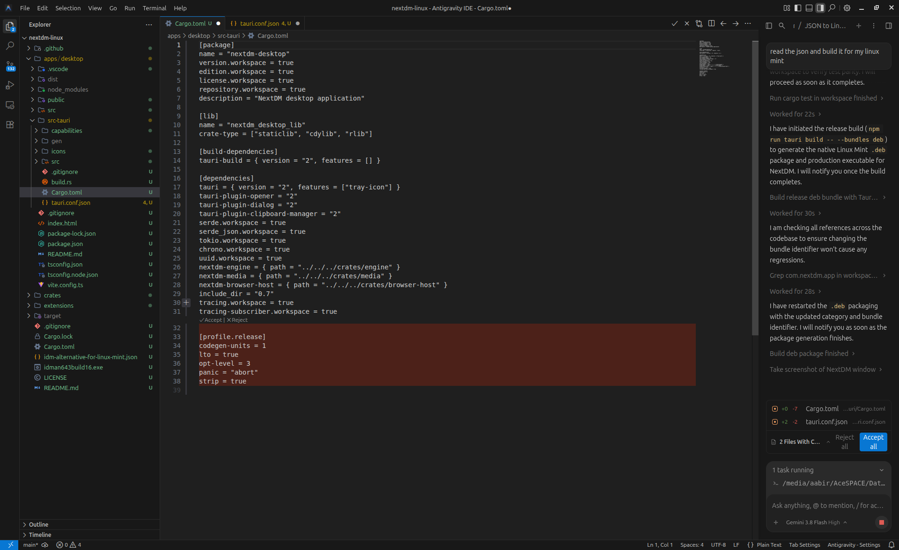

# NextDM

<p align="center">
  <strong>The Modern, High-Speed Download Manager for Linux</strong><br>
  <em>Crafted by <strong>Marbor Tech by Mahabub H. Aabir</strong></em>
</p>

<p align="center">
  <a href="https://github.com/mahabubaabir/nextdm/releases/latest"></a>
  
  
  
  <a href="CHANGELOG.md"></a>
</p>

---



NextDM is a fast, native download manager built for Windows and Linux (Linux Mint, Ubuntu, Debian, and derivatives). It provides segmented multi-connection acceleration, intelligent download interception, in-browser floating video downloader, and seamless background tray integration — without ads, telemetry, or account requirements.

---

## ⚡ Quick Download & Install (For Everyone)

Choose the installer for your computer:

### 🪟 Windows (11 / 10 / 8 / 7)
- 📦 **[Download Windows Setup Installer (.exe)](https://github.com/mahabubaabir/nextdm/releases/download/v0.2.0/NextDM_0.2.0_x64-setup.exe)** — *Recommended: 1-click installer with start menu & tray integration.*
- 🚀 **[Download Windows Standalone Portable (.exe)](https://github.com/mahabubaabir/nextdm/releases/download/v0.2.0/NextDM_0.2.0_x64_portable.exe)** — *No installation needed, run directly on any Windows PC.*

### 🐧 Linux (Linux Mint / Ubuntu / Debian)
- 🟢 **Install via Official APT Repository (Automatic Updates via Mint Update Manager):**
  ```bash
  echo "deb [arch=amd64 trusted=yes] https://raw.githubusercontent.com/mahabubaabir/nextdm/main/packaging/apt stable main" | sudo tee /etc/apt/sources.list.d/nextdm.list
  sudo apt update
  sudo apt install next-dm
  ```
- 📦 **[Direct Download NextDM 0.2.0 (.deb)](https://github.com/mahabubaabir/nextdm/releases/download/v0.2.0/NextDM_0.2.0_amd64.deb)** — *Install with `sudo dpkg -i NextDM_0.2.0_amd64.deb` or double-click to install.*

📜 **[View Full Changelog & Release History](CHANGELOG.md)**

---

## 🌟 Highlights & Key Features

- ⚡ **Multi-Connection Segmented Downloads**: Accelerate transfers with up to 32 parallel threads per file.
- 🎬 **In-Browser Video Grabber**: Floating download badge above web video players (YouTube, Facebook, Twitter, TikTok, and HTML5 players). Choose between a **Full Panel** or **Compact Mini Grabber** right from the app.
- 📋 **Pre-Download File Inspector ("Download File Info")**: Detects file sizes, file types, resume support, and suggests download folders before you start.
- 🎨 **Adaptive Theme Engine**:
  - **Liquid Glass**: Trending frosted translucent glassmorphism with dynamic gradients.
  - **Material 3 Expressive**: Modern rounded surface styling.
  - **Classic Linux Mint** & **Modern Dark Mode**.
  - **Monochrome Transparent Iconography**: Clean, minimalist vector icons that adapt seamlessly to light and dark themes.
- 🔄 **Smart Resume & Crash Recovery**: Interrupted transfers automatically resume from the last byte without corrupting files.
- 🚀 **Background System Tray & Autostart**: NextDM stays quietly in your system tray catching downloads and launches automatically on system boot.
- 🌐 **Browser Integration**: Automatic takeover for Chromium, Google Chrome, Brave, Microsoft Edge, Vivaldi, and Mozilla Firefox.
- 🔒 **100% Private & Free**: Zero tracking, zero ads, zero cloud telemetry. All settings and database files stay on your machine.

---

## 🌐 Browser Integration Setup

NextDM integrates seamlessly with your web browsers using the native messaging standard:

1. In NextDM, open **Options → Browser** and click **Register Native Messaging Host**.
2. Install the companion extension:
   - **Mozilla Firefox (Official 1-Click Install)**:
     Install directly from Mozilla Add-ons: [NextDM Integration on Firefox Add-ons](https://addons.mozilla.org/en-US/firefox/addon/nextdm-integration/)
   - **Chrome / Chromium / Brave / Edge / Vivaldi**:
     Go to `chrome://extensions`, enable **Developer mode**, click **Load unpacked**, and select the unpacked `chromium` folder (or upload the ready bundle to Chrome Web Store).

---

## 🛠️ System Requirements

- **Supported OS**: Linux Mint 21+, Ubuntu 22.04+, Debian 12+, or any modern GTK3 Linux distribution.
- **Optional Helper**: `yt-dlp` and `ffmpeg` for extracting and muxing high-resolution streams from video sites (`sudo apt install yt-dlp ffmpeg`).

---

<details>
<summary><b>🔧 Building from Source (For Developers)</b></summary>

### Prerequisites
- Rust 1.85+ (`rustup`)
- Node.js 20+
- System libraries:
  ```bash
  sudo apt install libwebkit2gtk-4.1-dev libgtk-3-dev librsvg2-dev \
    libayatana-appindicator3-dev patchelf build-essential curl wget file
  ```

### Development
```bash
git clone https://github.com/mahabubaabir/nextdm.git
cd nextdm/apps/desktop
npm install
npm run tauri dev
```

### Build .deb Package
```bash
npm run tauri build -- --bundles deb
```
</details>

---

## 📄 License & Credits

- Licensed under **GPL-3.0-or-later**.
- NextDM is created and maintained by **Marbor Tech by Mahabub H. Aabir**.
